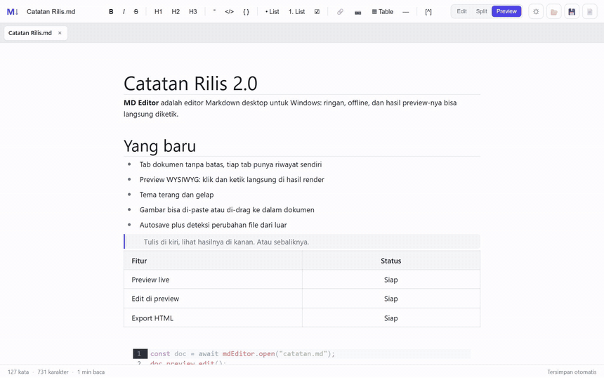
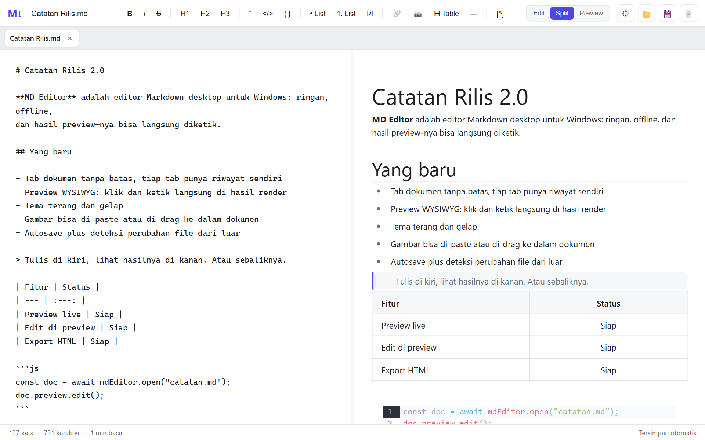
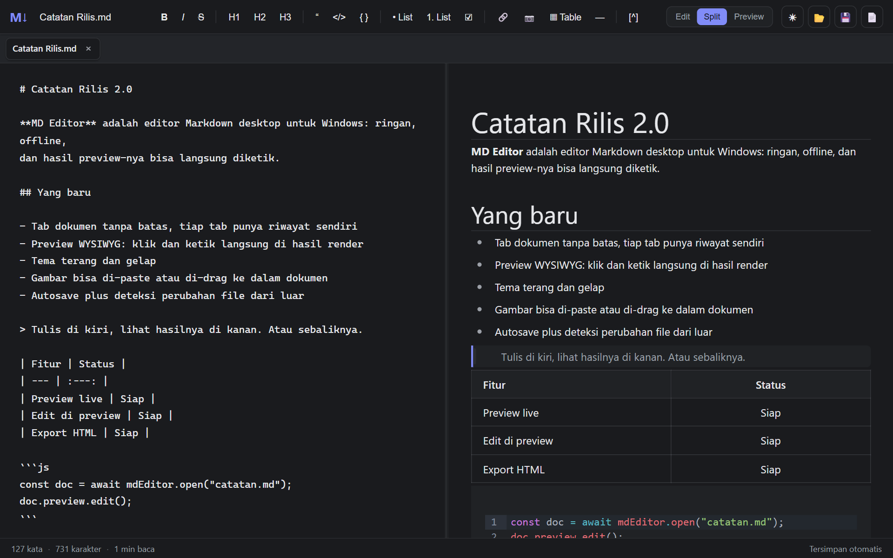

# MD Editor

**Editor Markdown desktop untuk Windows — preview-nya bisa langsung diketik.**



[](docs/demo.mp4)


Satu jendela, tab sebanyak yang kamu butuh, dan hasil render yang bukan cuma
pajangan: klik di preview, ketik, dan Markdown-nya ikut berubah.

Dibuat dengan Python + pywebview dan dibungkus jadi satu folder `.exe` yang
bisa dipindah ke mana saja — tanpa installer, tanpa akun, tanpa koneksi.

## Fitur

| | Fitur | Detail |
|:-:|---|---|
| ✍️ | **Preview yang bisa diedit** | Pane kanan ditenagai Milkdown Crepe. Klik paragraf, ketik langsung di hasil render, atau ketik `/` untuk menu blok. |
| 🗂️ | **Multi tab** | Tiap tab punya buffer, nama file, dan target autosave sendiri. Klik tengah untuk menutup, sesi dipulihkan saat aplikasi dibuka lagi. |
| 🪟 | **Tiga tampilan** | `Edit`, `Split`, `Preview`. Pembatas split bisa digeser. |
| 🌗 | **Tema terang & gelap** | Berlaku untuk UI, preview, sampai file HTML hasil ekspor. Pilihan diingat di server lokal. |
| 💾 | **Autosave + status** | Indikator di status bar: tersimpan, menyimpan, atau draft. `Ctrl+S` untuk simpan paksa. |
| 👀 | **Deteksi perubahan dari luar** | File berubah di disk (git pull, editor lain) → muncul peringatan "muat ulang dari disk" atau "pertahankan versi saya". |
| 🖼️ | **Gambar tanpa ribet** | Paste dari clipboard atau drag-drop ke editor; file disalin ke sebelah dokumen dan dirujuk lewat path relatif. |
| 📄 | **Ekspor HTML** | Satu file HTML mandiri, CSS-nya sudah di dalam, tema ikut. |
| 🔗 | **Satu instance** | Klik dua kali `.md` lain di Explorer → terbuka sebagai tab baru di jendela yang sudah jalan. |
| 📊 | **Statistik tulisan** | Jumlah kata, karakter, dan estimasi waktu baca, langsung di status bar. |

Dialek Markdown yang didukung: heading, tebal/miring/coret, kutipan, daftar
(termasuk task list), tabel, blok kode, gambar, tautan, garis horizontal, dan
catatan kaki (`[^1]`).

## Tampilan




Kiri: sumber Markdown. Kanan: hasil render yang sama, sekaligus tempat menulis.

## Mulai pakai

Unduh folder `MD Editor` hasil build, taruh di mana saja, lalu jalankan
`MD Editor.exe`. Tidak ada langkah instalasi.

## Build dari sumber

Butuh Windows dan Python 3.13.

```powershell
pip install pywebview
python -m PyInstaller "MD Editor.spec" --noconfirm --clean
```

Hasilnya ada di `dist/MD Editor/`. Tutup `MD Editor.exe` yang sedang berjalan
sebelum build ulang, karena file-nya terkunci.

Menjalankan langsung dari sumber:

```powershell
python app.py                 # jendela kosong
python app.py catatan.md      # langsung membuka file
```

## Pintasan

| Tombol | Fungsi |
|---|---|
| `Ctrl+B` / `Ctrl+I` | Tebal / miring |
| `Ctrl+K` | Sisipkan tautan |
| `Ctrl+S` | Simpan |
| `Tab` | Indentasi dua spasi di editor |
| `/` di awal blok (preview) | Menu blok: heading, daftar, tabel, kode |

## Arsitektur singkat

```
app.py            backend: server HTTP lokal + jendela pywebview, tulis/baca file,
                  pengaturan, upload gambar, dan handoff antar instance
index.html        kerangka UI
style.css         tampilan aplikasi
script.js         tab, parsing & render Markdown, autosave, tema, ekspor
rich-editor.js    bundle Milkdown Crepe (preview yang bisa diedit) — hasil generate
vendor/           sumber bundle + cara membuat ulang (lihat vendor/README.md)
test_*.py         test end-to-end headless lewat DevTools protocol
demo/             perekam video demo 30 detik (lihat di bawah)
```

Aplikasi berjalan sepenuhnya lokal: `webview` memuat halaman dari
`127.0.0.1`, dan hanya folder file yang dibuka yang disentuh.

## Test

```powershell
python test_multi_tab.py        # tab, handoff file kedua, autosave per tab
python test_rich_preview.py     # perintah toolbar di preview, mode tampilan, tema
python test_open_and_theme.py   # buka via ?path= dan keterbacaan UI tema gelap
python test_packaged_exe.py     # exe hasil build (jalankan setelah aplikasi hidup)
```

## Membuat ulang video demo

`docs/demo.gif` dan `docs/demo.mp4` direkam otomatis: skrip menjalankan
front end di Edge headless, memainkan 30 detik skenario, menangkap frame lewat
Chrome DevTools Protocol, lalu menyusunnya dengan ffmpeg.

```powershell
python demo/record.py           # rekam ulang + encode
python demo/record.py --smoke   # satu frame, untuk cek cepat
```

Butuh `ffmpeg` dan `pip install websocket-client`.
